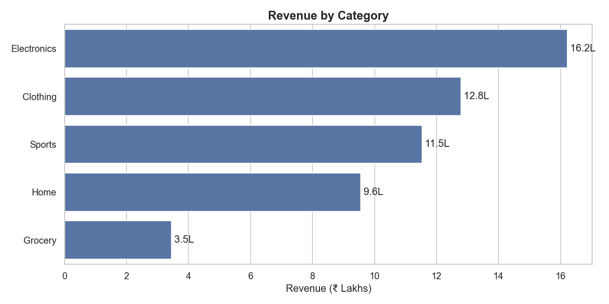
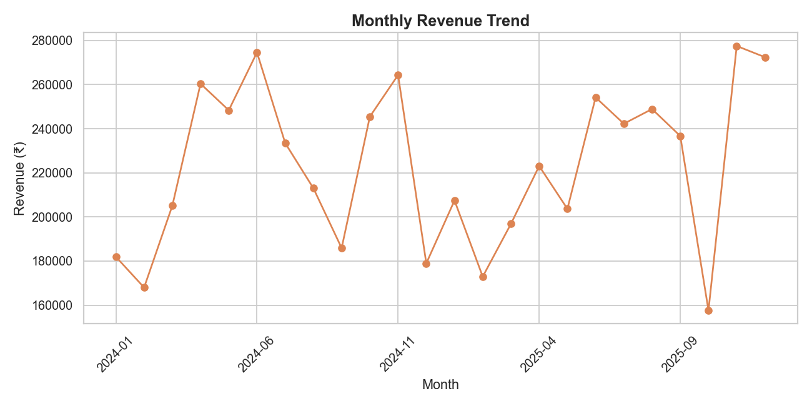
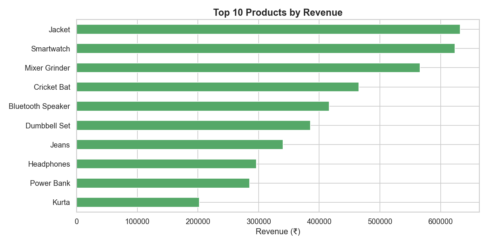
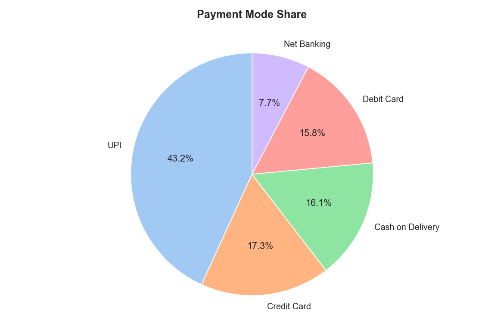
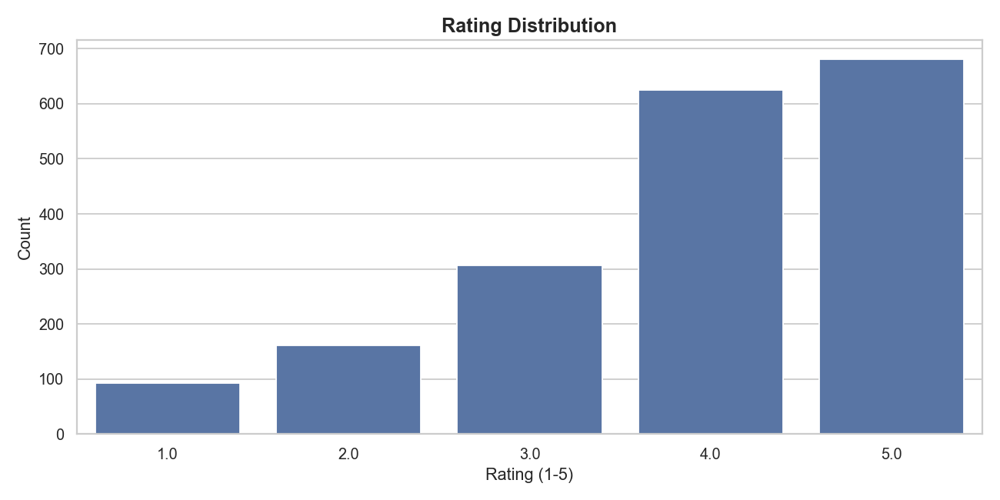
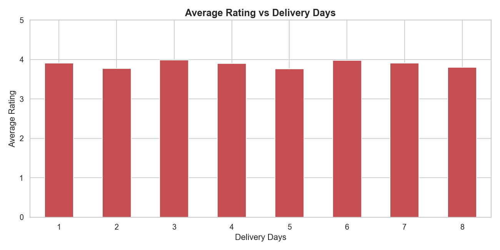
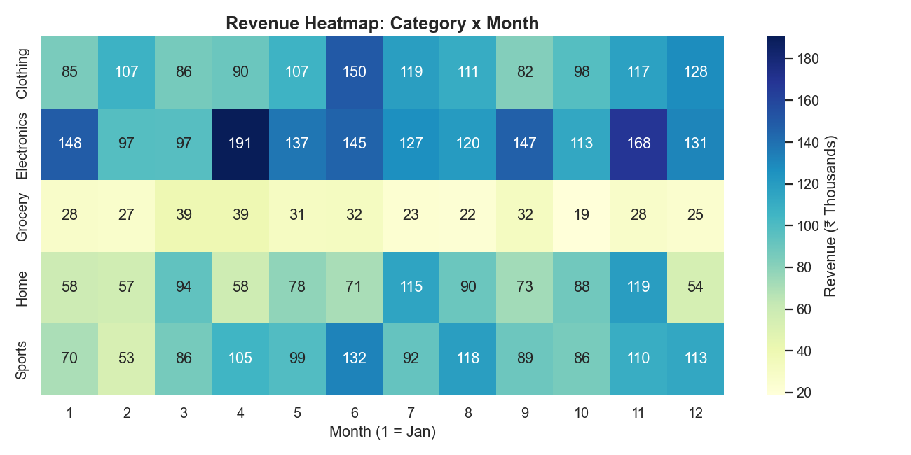
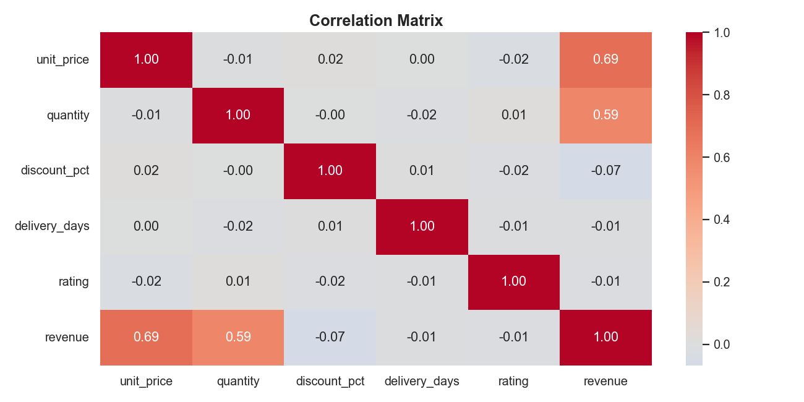

# 🛒 Retail Sales Analysis — Data Cleaning + EDA (Python)

An end-to-end data analysis project: a messy retail sales dataset is cleaned with **pandas**, new features are engineered, and business insights are extracted using **EDA and visualizations**.

---

## 📌 Project Overview

| Item | Detail |
|---|---|
| **Goal** | Clean a messy sales dataset and answer real business questions from it |
| **Raw data** | 2,060 rows × 12 columns |
| **Clean data** | 1,992 rows × 19 columns |
| **Period covered** | 2024 – 2025 |
| **Tools** | Python, pandas, NumPy, Matplotlib, Seaborn, Jupyter Notebook |

---

## 📂 Project Structure

```
retail-sales-analysis/
│
├── Retail_Sales_Analysis.ipynb     # Main notebook (cleaning + EDA)
├── raw_sales_data.csv              # Original messy dataset
├── data/
│   └── cleaned_sales_data.csv      # Cleaned dataset with new features
├── outputs/                        # All saved charts (PNG)
└── README.md
```

---

## 🧾 Dataset Columns

| Column | Description |
|---|---|
| `order_id` | Unique order ID |
| `order_date` | Date of order (came in 2 formats) |
| `customer_name` | Customer name |
| `city` | City of delivery |
| `category` | Product category |
| `product` | Product name |
| `unit_price` | Price of one unit (₹) |
| `quantity` | Units ordered |
| `discount_pct` | Discount given (%) |
| `payment_mode` | UPI / Credit Card / Debit Card etc. |
| `delivery_days` | Days taken to deliver |
| `rating` | Customer rating (1–5) |

**Engineered columns:** `gross_amount`, `revenue`, `year`, `month`, `month_name`, `weekday`, `year_month`

---

## 🧹 Data Cleaning Steps

| # | Problem found | Fix applied |
|---|---|---|
| 1 | **60 duplicate rows** | Removed with `drop_duplicates()` |
| 2 | **Inconsistent city text** (`mumbai`, `MUMBAI`, `Mumbai `, `Bangalore`/`Bengaluru`) | `str.strip().str.title()` + merged Bangalore → Bengaluru |
| 3 | **66 missing cities** | Filled with `"Unknown"` (rows kept, other info still useful) |
| 4 | **Dates in 2 formats** (`2024-04-24` and `24/04/2024`) | Parsed each format separately and combined → 0 unparsed dates |
| 5 | **72 missing discounts** | Filled with `0` (assumed no discount given) |
| 6 | **Missing ratings** | Deliberately **not filled** — inventing ratings would distort analysis |
| 7 | **Outliers:** quantity = 500, negative `delivery_days` | Removed rows with `quantity > 10` or `delivery_days < 1` |

**Result: 2,060 → 1,992 rows**

---

## ⚙️ Feature Engineering

```python
gross_amount = unit_price * quantity
revenue      = gross_amount * (1 - discount_pct / 100)
```
Plus date parts: `year`, `month`, `month_name`, `weekday`, `year_month`.

---

## 📊 Key Metrics (KPIs)

| Metric | Value |
|---|---|
| Total Revenue | ₹53,53,231 (≈ ₹53.5 Lakh) |
| Total Orders | 1,992 |
| Average Order Value | ₹2,687 |
| Average Rating | 3.88 / 5 |
| Average Delivery Time | 4.6 days |

---

## 🔍 Analysis Questions Answered

1. Which category brings the most revenue?
2. What does the monthly sales trend look like?
3. Which are the top 10 products?
4. Which city places the most orders?
5. How do customers pay?
6. What does the rating distribution look like?
7. Does late delivery lower the rating?
8. Category × Month revenue heatmap
9. Correlation between numeric columns
10. Does a bigger discount increase quantity sold?

---

## 💡 Key Insights

- 🏆 **Top category:** Electronics — ≈ ₹16.2 Lakh revenue
- 🏙️ **Top city:** Mumbai — 310 orders
- 💳 **Most used payment mode:** UPI (~43%)
- 📅 **Best month:** November 2025 — ₹2.78 Lakh revenue
- 📆 **Best weekday:** Thursday
- ⭐ **Average rating:** 3.88 / 5
- 🏷️ **Discounts did not increase quantity** — average quantity stayed ≈ 2.0–2.15 across 0% to 20% discount, so deep discounts only reduce revenue here.

### ✅ Business Recommendations
- Increase inventory and marketing for **Electronics**.
- Run targeted campaigns in cities with fewer orders.
- Offer **UPI cashback** since UPI is the most popular payment mode.
- Stock up before the best-performing month (**November**).
- Re-evaluate heavy discounts — they don't lift volume.

---

## 🖼️ Visualizations

| Revenue by Category | Monthly Revenue Trend |
|---|---|
|  |  |

| Top 10 Products | Payment Modes |
|---|---|
|  |  |

| Rating Distribution | Rating vs Delivery Days |
|---|---|
|  |  |

| Category × Month Heatmap | Correlation Matrix |
|---|---|
|  |  |

---

## 🚀 How to Run

```bash
# 1. Clone the repo
git clone https://github.com/<your-username>/retail-sales-analysis.git
cd retail-sales-analysis

# 2. Install libraries
pip install pandas numpy matplotlib seaborn jupyter

# 3. Open the notebook
jupyter notebook Retail_Sales_Analysis.ipynb
```
> Make sure `raw_sales_data.csv` is in the same folder as the notebook. Running it creates `data/` and `outputs/` automatically.

---

## 🧠 Skills Demonstrated

- Data cleaning (duplicates, missing values, inconsistent text, mixed date formats, outliers)
- Feature engineering
- Exploratory Data Analysis with Matplotlib & Seaborn
- Turning data into business recommendations

---

## 👤 Author

Sumedh Wankhade (Aspiring Data Analyst)
**Skills:** Excel | SQL | Python | Power BI 
